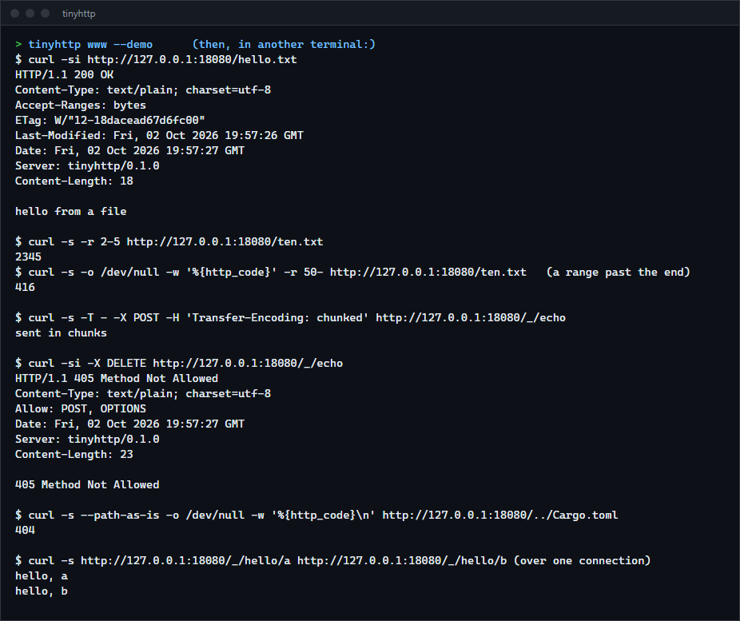

# tinyhttp

An HTTP/1.1 server written on `std::net` alone: strict request parsing, routing, keep-alive, pipelining, chunked bodies in both directions, a static file server with ranges and conditional requests, timeouts and graceful shutdown. It is a library with a small file-server binary, for anyone who wants to read how a web server works underneath or needs a dependency-free one for tools and tests.

**Status:** v0.1.0, working on Windows. The Linux build is compile-checked only. No TLS and no HTTP/2. Not published to crates.io.



## Features

- Strict parsing: bare line feeds, spaces before a colon, folded headers, conflicting `Content-Length` values and `Content-Length` together with `Transfer-Encoding` are errors, which is what stops request smuggling. Limits on the request line, the head, the number of headers and the body.
- Keep-alive, pipelining (requests that arrive together are answered in order), `Expect: 100-continue`, HTTP/1.0 clients.
- Chunked transfer coding in requests (an incremental decoder) and in responses (streaming handlers).
- Routing by method and pattern (`/users/:id`, `/files/*path`), automatic `405` with `Allow`, `OPTIONS`, `HEAD` through `GET`.
- A file server: MIME types, `ETag` and `Last-Modified`, `If-None-Match` and `If-Modified-Since` (304), `Range` (206 and 416, so downloads can resume), `If-Range`, index files, optional directory listing with HTML escaping.
- Defences in the file server: no `..`, no backslashes or drive letters or alternate data streams, no Windows device names, no trailing dots or spaces, no dotfiles by default, no symbolic link that leaves the root, and redirects that cannot become `//other.site/`.
- A worker pool with a bounded queue that answers `503` when full, idle, head and body timeouts, a limit on requests per connection, a handler that panics gives `500`, and a shutdown that finishes requests in progress and closes idle connections.

## How to install

Requires a recent stable Rust (built and tested with 1.98.1).

```sh
git clone https://github.com/r3clusionn/http-server
cd http-server
cargo install --path .
```

## How to use

```sh
tinyhttp                      # serve the current directory on http://127.0.0.1:8080
tinyhttp site --port 3000 -l  # serve ./site, list directories without an index.html
tinyhttp . --demo             # add the demonstration endpoints under /_/
```

| Option | What it does |
|---|---|
| `DIR` | Directory to serve (default `.`). |
| `-b, --bind ADDR`, `-p, --port N` | Address and port (default 127.0.0.1:8080). Use `0.0.0.0` to serve other machines. |
| `-l, --listing` | List directories that have no `index.html`. |
| `--hidden` | Serve files and directories whose name starts with a dot. |
| `-t, --threads N` | Worker threads, which is also how many clients are served at the same moment (default: 2 per CPU, at least 4). |
| `--idle S` | Seconds a kept-alive connection may stay idle (default 5). |
| `--max-requests N` | Requests per connection before it is closed (default 1000, 0 for no limit). |
| `--max-body KiB` | Largest request body (default 1024). |
| `--cache-control VALUE` | `Cache-Control` header for files. |
| `--demo` | Endpoints under `/_/`: `hello/:name`, `echo` (POST), `headers`, `stream?n=&size=&delay_ms=`, `sleep?ms=`, `big?mib=`, `panic`, `stats`. |
| `-q, --quiet` | No access log. |

### As a library

```rust
use std::sync::Arc;
use tinyhttp::{Config, FileServer, Response, Router, Server};

let files = Arc::new(FileServer::new("public").unwrap());
let router = Router::new()
    .get("/api/hello/:name", |_, p| Response::text(200, format!("hello, {}\n", p.get("name").unwrap())))
    .post("/api/echo", |req, _| Response::bytes(200, "application/octet-stream", req.body.clone()))
    .get("/api/count", |_, _| Response::stream(200, "text/plain", |w| {
        for i in 0..5 {
            writeln!(w, "{i}")?; // sent as a chunk each time
        }
        Ok(())
    }))
    .fallback(move |req, _| files.handle(req));

let server = Server::start("127.0.0.1:8080", router, Config::default()).unwrap();
// ... later:
server.shutdown();
```

`examples/library.rs` is this program, complete.

## How it works

- **Parsing.** `parse_head` looks at the bytes received so far and says "incomplete", "here is a head and it used N bytes" or "refuse with this status". Because the same function is called again as more bytes arrive, the result cannot depend on how the network split the request; a test feeds every prefix and a fuzz test mutates valid requests and random bytes. The body is read separately by `Content-Length` or by the chunked decoder, which is a state machine whose output is the same for every split point (tested at every position and one byte at a time).
- **One connection, one loop.** A worker reads a head, reads the body, calls the router, writes the response and starts over with whatever bytes were left in its buffer, which is how pipelining works without a special case. Reads wake up every 200 ms to check the deadline and the shutdown flag.
- **Closing politely.** After an error response the server shuts down its sending side and reads and discards what the client is still sending for up to half a second. Closing a socket with unread data makes TCP send a reset, which can destroy the error response before the client reads it; a test fails if this is removed.
- **Overload.** Connections wait in a bounded queue for a free worker. When it is full the acceptor writes a `503` itself and closes, so a flood costs one short write per connection rather than a growing backlog. Because a worker serves one connection at a time, slow keep-alive clients occupy workers until the idle timeout; that is the main limit of this design.
- **File paths** go through three layers: a per-segment check (`..`, separators, `:`, device names, trailing dots, dotfiles), `canonicalize` to resolve links, and a check that the real location is still inside the root.

## Benchmarks

Measured on an Intel Core i9-14900KF, Windows 11, Rust 1.98.1, over loopback with the load generator on the same machine (`scripts/bench.sh`). The load generator (`examples/loadgen.rs`) keeps N connections open and sends the next GET as soon as a response is complete. The comparison is a server built on the `tiny_http` 0.12 crate with the same body and `Content-Length` (`examples/baseline.rs`). Both had 32 worker threads, 3 runs of 5 seconds each, median shown; none had a failed request or a reconnect.

| Load | tinyhttp | tiny_http |
|---|---|---|
| 13-byte response, 1 client | 72,100 req/s, p50 12 us | 54,600 req/s, p50 17 us |
| 13-byte response, 8 clients | 288,600 req/s | 233,700 req/s |
| 13-byte response, 32 clients | 404,400 req/s, p99 187 us | 378,000 req/s, p99 396 us |
| 1 MiB response, 1 client | 1,763 req/s (1.85 GB/s) | 839 req/s (0.88 GB/s) |
| 1 MiB response, 8 clients | 6,148 req/s (6.4 GB/s) | 4,091 req/s (4.3 GB/s) |

Both servers build the 1 MiB body for every request (tinyhttp fills a new buffer, the baseline copies a prepared one). The differences say little beyond "the same order of magnitude": the baseline does more (it parses and keeps more headers, supports more of HTTP), and loopback hides the network.

## Verification

- `cargo test --release` runs 43 unit tests, 23 integration tests over real sockets, 11 file-server tests and a doc test. The integration tests use a separate minimal client written for the purpose, so the server is not tested against its own parser.
- The tests cover: pipelining with a request hidden in a body, a request arriving one byte at a time, chunked bodies sent in pieces, `100-continue`, framing after `HEAD`, 10 kinds of malformed request, a request-smuggling attempt (the second request must never run), size limits at the exact boundary, slow clients (idle, head, body, and a client that dribbles one byte at a time), a full queue giving `503` immediately, parallel service, 48 clients with 25 requests each, a panicking handler, graceful shutdown, 32 MiB responses, and more than 30 traversal, encoding and device-name attempts against a file outside the root.
- Mutation checks, each confirmed to fail a test when removed: the bare line feed check, `Content-Length` with `Transfer-Encoding`, conflicting `Content-Length`, header name validation, the `HEAD` body rule, both body limits, header injection, the `503`, the idle shutdown, the lingering close, the open redirect fix, the symlink check, and the combined traversal layers. The explicit `..` rule and the device-name rule survive when removed alone, because the trailing-dot rule and `canonicalize` also stop those requests; the layers back each other up.
- curl 8.21 (an independent client) was run against the binary: ranges, resuming a download (`-C`), chunked upload, `Expect: 100-continue`, one connection for several URLs and one per URL with `-0`, `--path-as-is` traversal, and `If-None-Match`.
- The integration tests were run six times in a row without a failure.

## Limits

- No TLS, no HTTP/2, no compression, no `multipart` or form parsing.
- A worker serves one connection at a time, so more simultaneous keep-alive clients than workers wait in the queue (or get `503`).
- Only one `bytes` range per request; several ranges get the whole file. `If-Match` and `If-Unmodified-Since` are not implemented, and only the IMF date format is parsed.
- Matching of route patterns is exact: `/a` and `/a/` are different paths.
- Only Windows was run. The code uses nothing but `std`, and the library and binary were compile-checked for `x86_64-unknown-linux-musl`.

## License

MIT (see `LICENSE`).
